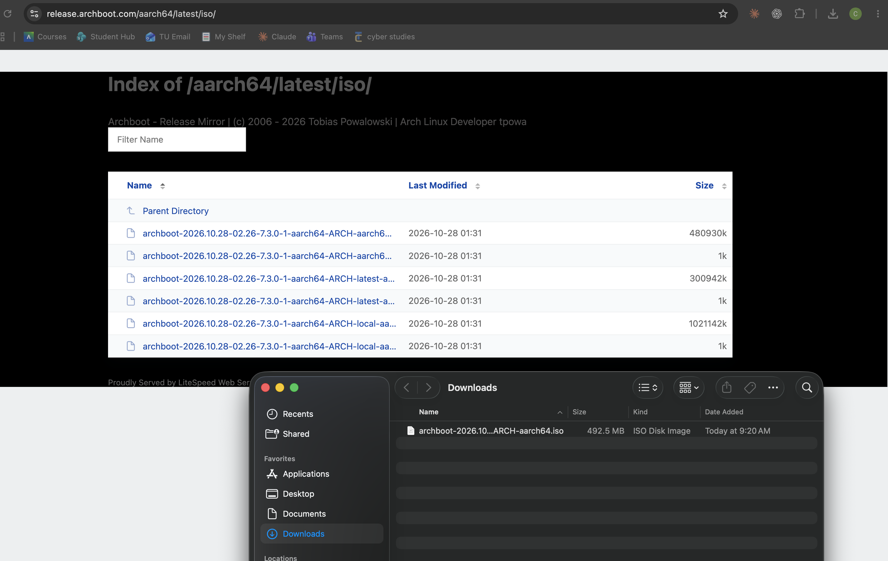
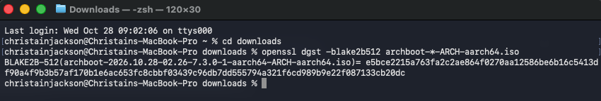
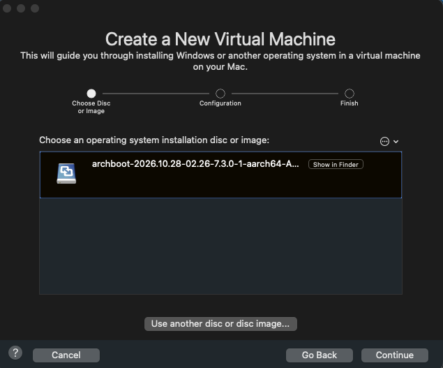
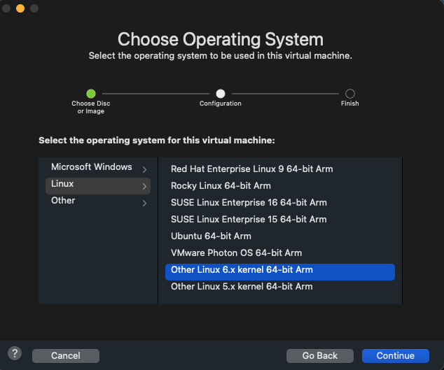
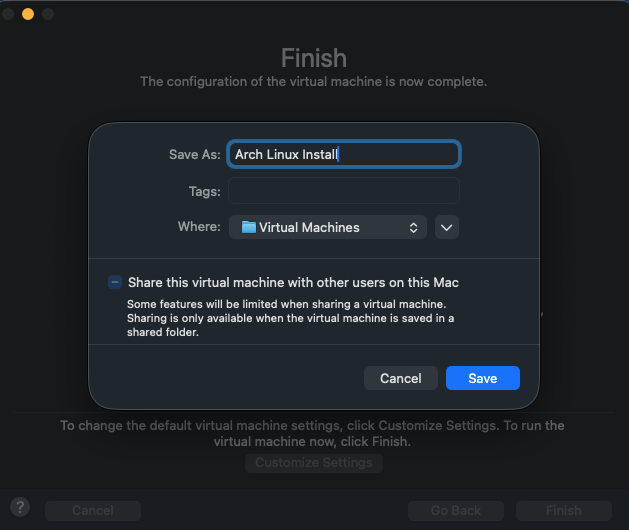
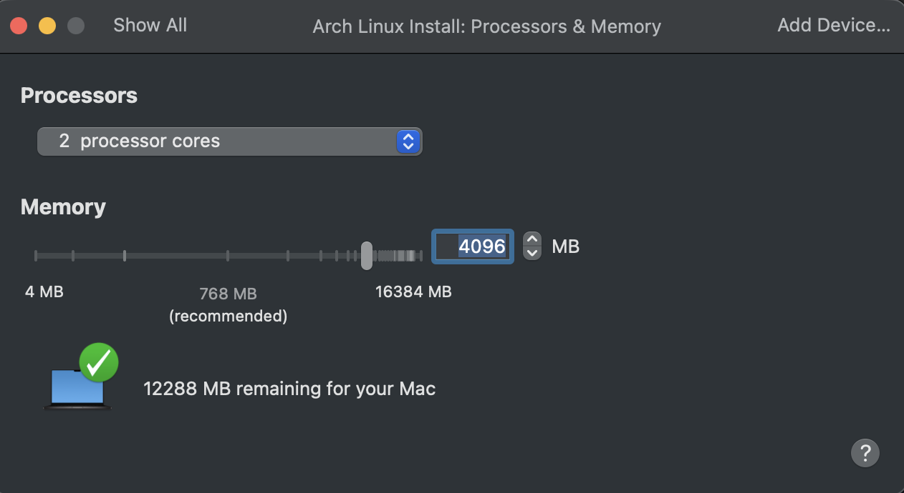
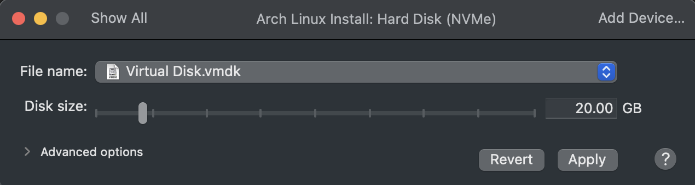

# Arch Linux VM Installation - Christian Jackson

## 0. VM Setup

### 0.1 - Download the ISO

Download the standard Iso from https://release.archboot.com/aarch64/latest/iso/



### 0.2 - Verify the ISO (BLAKE2b)

The result should exactly match this line from b2sum.txt:

```
e5bce2215a763fa2c2ae864f0270aa12586be6b16c5413df90a4f9b3b57af170b1e6ac653fc8cbbf03439c96db7dd555794a321f6cd989b9e22f087133cb20dc
```

**Command:** `openssl dgst -blake2b512 archboot-*-ARCH-aarch64.iso`

**What it does:** Calculates a fingerprint hash of the ISO file so you can check that it downloaded correctly.



### 0.3 - Create a new VM

Go to VMWare Virtual Machine Library and click new

### 0.4 - Add the ISO

Now drag the Iso file in the tab that pops up. Should look like this:



### 0.5 - Choose the OS

Next choose linux -> other linux 6.x kernel 64-bit Arm as your OS



### 0.6 - Finish and customize

On the finish screen click customize and save it as Arch Linux Install



### 0.7 - Processors & Memory

Click save and the VM should pop up with setting options. Click processors & memory.

Use the slider to select 4096 MB and 2 cores (I have 16GB so I went above the minimum 2048 MB, but if you have less to work with choose 2048 MB)



### 0.8 - Hard Disk

Now click "Show All" and go to Hard Disk (NVMe).

Set disk size to 20 GB and click "Apply"



## 1. Pre-Installation

### 1.1 - Boot the Live Environment

Click the play button inside VMWare and let the new VM boot up. Then CTRL-C for bash prompt.

I ran into a problem where when my VM would boot into the menu shown below, the screen was frozen and my keyboard could not access the console. This was fixed by pressing 'e' on "Launch UEFI Archboot" in the GRUB menu, adding `video=efifb:off` after `systemd.show_status=false`, then pressing CTRL+X.


### 1.2 - Verify the Boot Mode

**Command:** `cat /sys/firmware/efi/fw_platform_size`

**What it does:** prints the firmwares bit size to verify the system booted through UEFI.

**Expected Output:** 64


### 1.3 - Connect to the Internet

**Commands:**
```
ip link                   # lists network interfaces
ping -c 3 archlinux.org   # sends 3 test packets to verify internet + DNS
```

**Expected Output:** Ping should report 3 received.


### 1.4 - Update System Clock

**Command:** 
```
timedatectl   # shows time status

# if NTP service is inactive
timedatectl set-ntp true  # turns on automatic time sync 
timedatectl               # Should now show active
```


### 1.5 - Partition the Disks

`lsblk  # list block devices: shows every storage device Linux can see`


`fdisk /dev/nvme0n1   # opens the partition editor on the 20GB disk`

Type these commands in order:

| #   | Command | What it does                                                        |
| --- | ------- | ------------------------------------------------------------------- |
| 1   | `g`     | Creates a new GPT partition table, which UEFI requires              |
| 2   | `n`     | New partition (partition 1)                                         |
| 3   | *Enter* | Accept partition number **1**                                       |
| 4   | *Enter* | Accept the default first sector                                     |
| 5   | `+500M` | Make it 500 MB (slide 14)                                           |
| 6   | `t`     | Change partition type                                               |
| 7   | `1`     | Type 1 = EFI System                                                 |
| 8   | `n`     | New partition (partition 2)                                         |
| 9   | *Enter* | Accept partition number **2**                                       |
| 10  | *Enter* | Accept the default first sector                                     |
| 11  | *Enter* | Accept the default last sector, which uses **the rest of the disk** |
| 12  | `p`     | **Print** the planned layout.                                       |
| 13  | `w`     | **Write** the partition table to disk and exit fdisk                |

After writing this, your device should match this:


### 1.6 - Format the Partitions

Commands:
```
mkfs.ext4 /dev/nvme0n1p2        # formats the root partition as ext4
mkfs.fat -F 32 /dev/nvme0n1p1   # formats the EFI partition as FAT32 (required by UEFI)
```


### 1.7 - Mount the File Systems

Commands:
```
mount /dev/nvme0n1p2 /mnt                 # mounts the root partition at /mnt                                              
mount --mkdir /dev/nvme0n1p1 /mnt/boot    # creates /mnt/boot and mounts the EFI partition there

lsblk                                     # verify the mount points
```


## 2. Installation

### 2.1 - Select the Mirrors

Commands:
```
grep -v '^#' /etc/pacman.d/mirrorlist | grep -v '^$'   # shows the active (uncommented) mirror servers

grep '^\[' /etc/pacman.conf                              # lists the enabled package repositories

pacman -Sy                                               # downloads the latest package lists from those mirrors

pacman -Ss '^linux' | grep -E '^[a-z]+/linux(-aarch64)? '   # finds which kernel package exists in these repos
```


### 2.2 - Install Essential Packages

`pacstrap -K /mnt base linux-aarch64 linux-firmware archlinuxarm-keyring networkmanager nano sudo man-db man-pages`

What this installs:

| Package                | Why                                                                                 |
| ---------------------- | ----------------------------------------------------------------------------------- |
| `base`                 | The minimal Arch system                                                             |
| `linux-aarch64`        | The ARM kernel, replacing linux from the wiki                                       |
| `linux-firmware`       | Hardware firmware. The wiki says it can be skipped in a VM, but it's harmless.      |
| `archlinuxarm-keyring` | ALARM's signing keys. Without them, the installed system can't verify ARM packages. |
| `networkmanager`       | Networking after reboot.                                                            |
| `nano`                 | A text editor for config files                                                      |
| `sudo`                 | Needed for the "sudo permissions" requirement                                       |
| `man-db`               | The man command for reading manual pages                                            |
| `man-pages`            | The manual pages themselves                                                         |


## 3. Configure the System

### 3.1 - Fstab

Commands:
```
genfstab -U /mnt >> /mnt/etc/fstab   # generates the filesystem table (by UUID) so the system knows what to mount at boot

cat /mnt/etc/fstab                   # check the result
```


### 3.2 - Chroot

`arch-chroot /mnt   # switches into the new system as if it were booted; the prompt will change`


### 3.3 - Time

Commands:
```
ln -sf /usr/share/zoneinfo/America/Chicago /etc/localtime   # sets the timezone to Central by linking to its zone file

hwclock --systohc                                           # writes the correct system time to the hardware clock

date                                                        # should show the current Central time (CDT/CST)
```


### 3.4 - Localization

Commands:
```
export TERM=linux        # archboot's console sets TERM=kmscon, which the new system doesn't recognize; nano won't open without this

nano /etc/locale.gen     # opens the list of available locales
```


In nano:
1. press Ctrl+W, type en_US.UTF-8 and press enter
2. Delete the # at the start of the line en_US.UTF-8 UTF-8
3. Press Ctrl+O, then Enter to save, then Ctrl+X to exit


Commands:
```
locale-gen                                # generates the locale you uncommented

echo "LANG=en_US.UTF-8" > /etc/locale.conf    # sets it as the system language
```


### 3.5 - Network Configuration

Commands:
```
echo "arch-install-lab" > /etc/hostname   # sets the computer's hostname

systemctl enable NetworkManager           # starts NetworkManager automatically at every boot
```


### 3.6 - Root Password

`passwd   # sets the password for the root account`

### 3.7 - Boot Loader

Commands:
```
ls /boot              # lists the kernel and initramfs files pacstrap installed

bootctl install       # installs systemd-boot to the EFI partition and adds it to the UEFI boot menu
```


Create 2 config files

File 1 commands:

```
echo "default arch.conf" > /boot/loader/loader.conf   # boot the Arch entry by default

echo "timeout 3" >> /boot/loader/loader.conf          # show the boot menu for 3 seconds
```

File 2 commands:

```
# name shown in the boot menu
echo "title   Arch Linux" > /boot/loader/entries/arch.conf                      

# the kernel to load
echo "linux   /Image" >> /boot/loader/entries/arch.conf      

# the initial ramdisk to load with it                 
echo "initrd  /initramfs-linux.img" >> /boot/loader/entries/arch.conf    

# root partition, mount read-write, and the display fix     
echo "options root=UUID=$(blkid -s UUID -o value /dev/nvme0n1p2) rw video=efifb:off" >> /boot/loader/entries/arch.conf
```

Commands to check both files:
```
cat /boot/loader/loader.conf          # show the menu config
cat /boot/loader/entries/arch.conf    # show the boot entry
```


## 4. Reboot

Commands:
```
exit            # leaves the chroot, back to the archboot live environment

umount -R /mnt  # unmounts all partitions under /mnt recursively so everything is safely written to disk

poweroff        # shuts down the VM
```

Then:
1. Open the VM settings and go to CD/DVD (SATA)
2. Uncheck "Connect CD/DVD Drive"
3. Close settings and press the play button to boot your VM


You should see this with your own hostname, then login as root


## 5. Post-Installation

### 5.1 - Check the network and update

Commands:
```
ping -c 3 archlinux.org   # confirms NetworkManager brought up the network on boot

pacman -Syu               # syncs package lists and updates everything to the latest versions
```


### 5.2 - Create users with sudo

Commands:
```
useradd -m -G wheel cdj6323   # creates your user with a home folder (-m) and adds it to the wheel (admin) group (-G wheel)

passwd cdj6323                # sets your user's password

useradd -m -G wheel codi      # creates the codi user the same way

passwd codi                   # sets codi's password

EDITOR=nano visudo            # safely opens the sudo config file in nano
```


In nano:
1. Press Ctrl+W and search for %wheel ALL=(ALL:ALL) ALL
2. Delete the # and the space in front of it
3. Save and exit with Ctrl+O, Enter, Ctrl+X


Verify Commands:
```
grep wheel /etc/group              # shows the wheel group and its members: should list cdj6323,codi

grep '^%wheel' /etc/sudoers        # shows the active sudo rule for wheel
```


### 5.3 - Install zsh and make it the default shell

Commands:
```
pacman -S zsh zsh-completions    # installs the Z shell plus extra tab-completion definitions

chsh -s /usr/bin/zsh cdj6323     # changes your user's default login shell to zsh

chsh -s /usr/bin/zsh codi        # same for codi (optional, keeps both users 
consistent)

grep -E 'cdj6323|codi' /etc/passwd   # verify: each line should end in /usr/bin/zsh
```


### 5.4 - Install and Enable SSH

Commands:
```
pacman -S openssh                  # installs the OpenSSH client and server

systemctl enable --now sshd        # starts the SSH server now and at every boot

systemctl status sshd --no-pager   # verify: should show "active (running)"
```


### 5.5 - Desktop Environment, LXQt + SDDM

1. Check that the graphics driver is working
   `ls /dev/dri`


2. Install the desktop
   `pacman -S xorg-server lxqt sddm breeze-icons ttf-dejavu   # display server, LXQt desktop, login screen, icons, fonts`

   Press enter on all three of the prompts that show automatically
   


3. Boot into the GUI automatically
   `systemctl enable sddm # starts the SDDM graphical login screen at every boot`


4. `reboot`


### 5.6 - Terminal Colors

Commands:
```
nano ~/.zshrc   # opens your zsh config file (~ = your home folder)

# Type this

# Colors
PROMPT='%F{green}%n%f@%F{cyan}%m%f %F{blue}%~%f %# '
alias ls='ls --color=auto'
alias grep='grep --color=auto'
alias diff='diff --color=auto'
alias ip='ip -color=auto'
```


### 5.7 - Aliases

On the next lines of the same file add these
```
# Aliases

alias ll='ls -lah'               # long list, all files, human-readable sizes
alias ..='cd ..'                 # go up one folder
alias c='clear'                  # clear the screen
alias h='history'                # show command history
alias update='sudo pacman -Syu'  # update the whole system
alias ports='ss -tulanp'         # show listening ports (e.g., ssh on 22)
```


Save and exit with Ctrl+O, Enter, Ctrl+X, then reload the file and test it:

```
source ~/.zshrc   # reloads the config so changes take effect now
ll                # should show a colored, detailed file list
alias             # lists all your aliases
```


### 5.8 - Install Firefox

`sudo pacman -S firefox`


### 5.9 - AUR setup

Commands:
```
sudo pacman -S --needed git base-devel                  # git (download AUR sources) + build tools (makepkg, gcc, etc.)

git clone https://aur.archlinux.org/yay-bin.git         # downloads the yay AUR helper's build files from the AUR

cd yay-bin                                              # enter that folder

makepkg -si                                             # builds the package and installs it (-s: install deps, -i: install)

cd .. && rm -rf yay-bin                                 # go back and clean up the build folder

yay --version                                           # verify yay is installed
```


## Problems/Questions and Fixes/Answers

1. **Problem:** The VM started booting automatically after creation, before I was able to adjust the settings.

   **Fix:** Typed poweroff in the vm and hit enter.

2. **Problem:** Couldn't type in the archboot console.

   **Fix:** In the GRUB menu, press 'e' on "Launch UEFI Archboot", add `video=efifb:off` after `systemd.show_status=false`, then press Ctrl+X.

3. **Problem:** I accidentally deleted the ISO file in my downloads folder so it wouldn't boot my VM.

   **Fix:** Restored the file from my trash bin.

4. **Problem:** In 3.4, running `nano /etc/locale.gen` inside the chroot failed with `ncurses: cannot initialize terminal type ($TERM="kmscon"); exiting`.

   **Cause:** Archboot's console runs a program called kmscon, which sets the terminal type to `TERM=kmscon`. The new Arch system I chrooted into doesn't have a definition for that terminal type, so nano didn't know how to draw its screen.

   **Fix:** Ran `export TERM=linux` to switch to the standard Linux console terminal type, then reopened nano. 

5. **Problem:** the hostname is missing from my prompt line

   **Fix:** My file has - PROMPT='%F{green}%n%f@%F %F{blue}%~%f %# '
   
      It Should be - PROMPT='%F{green}%n%f@%F{cyan}%m%f %F{blue}%~%f %# '
      ```
      nano ~/.zshrc     # fix the PROMPT line
      source ~/.zshrc   # reload
      ```

   
